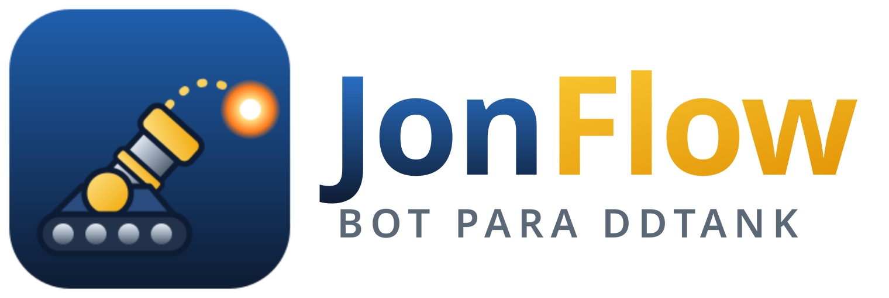

# JonFlow

**JonFlow** (antes chamado *DDClássico Bot*) é um aplicativo para Windows 10/11 (64 bits) que joga **partidas e
instâncias PvE do DDTank no servidor DDClássico sozinho**. Você escolhe
a atividade, clica em **Iniciar** e o bot navega pelos menus, entra na atividade, reconhece os turnos, mira e
atira, avança as etapas, reconhece vitória e derrota e recomeça até completar a quantidade configurada.

> **Aviso importante.** As regras do DDClássico sobre programas de automação **não puderam ser verificadas**
> (o site bloqueou o acesso durante a pesquisa). Muitos servidores punem o uso de bots com banimento. Leia os
> Termos do servidor antes de usar o modo automático. O uso é por sua conta e risco.

---

## Para quem vai só usar

### 1. Abrir

Baixe na página de **Releases** do repositório no GitHub. Há dois formatos:

- **`JonFlow.zip`** (recomendado): extraia numa pasta (botão direito → *Extrair tudo*), abra a pasta
  `JonFlow` e clique duas vezes em **`JonFlow.exe`**. Esse `.exe` precisa da pasta `_internal` ao
  lado dele: não o tire da pasta.
- **`JonFlow.exe`** (arquivo único): roda sozinho, sem pasta nenhuma. Coloque-o numa pasta só para ele,
  porque ele cria a pasta `dados` ao lado de si. Abre alguns segundos mais devagar.

Não precisa instalar Python nem nenhum outro programa.
3. Se o Windows mostrar "O Windows protegeu o computador", clique em *Mais informações* → *Executar assim mesmo*
   (o executável não tem assinatura digital).

Quer conhecer a tela antes de configurar o jogo? Ligue **Modo demonstração** no canto superior direito: aparecem
o Formigueiro, o Galinheiro e o Castelo de Bugou (Normal) simulados, uma instância e uma partida de demonstração.
Clique em **Iniciar**. Nesse modo nada é enviado ao jogo, a faixa de estado diz "Demonstração" e os resultados são
de um jogo simulado, não do DDClássico.

Quem já usava o *DDClássico Bot*: substitua os arquivos e mantenha a pasta `dados`. Se os dados estavam em
`%LOCALAPPDATA%\DDClassicoBot`, o JonFlow continua usando essa pasta.

### 2. Primeira configuração (uma vez só)

O bot "enxerga" o jogo por imagens que **você captura do seu próprio cliente**. Por isso funciona com a sua
resolução e a sua versão do jogo, e nada é inventado. Com o jogo aberto, deixe a janela num tamanho fixo e:

1. **Detectar jogo.** Abra o DDClássico pelo launcher e clique em **Detectar jogo**, no topo. A janela do JonFlow
   se minimiza para não cobrir o launcher nem o jogo, e o bot procura sozinho:
   - se o jogo já está aberto, ele conecta e mostra uma **prévia** para você conferir;
   - se só o launcher está aberto, ele avisa e **espera**: entre no jogo pelo launcher e ele conecta sozinho quando
     a janela do jogo aparecer (em outra janela ou dentro do próprio launcher);
   - se não tiver certeza, pergunta com a prévia na tela: **Sim, é o jogo** ou **Não, é o launcher**;
   - se houver mais de uma janela possível, mostra a lista com prévia para você escolher;
   - se não achar, use **Mostrar onde está o jogo**: a tela escurece e você clica sobre a janela do jogo (o clique
     não chega ao jogo; Esc cancela).

   Ao fechar, a janela do JonFlow volta como estava. Daí em diante o bot reencontra o jogo sozinho, mesmo quando
   você fecha e abre de novo pelo launcher. As pistas que ele usa: qual processo abriu qual (o launcher abre o
   jogo), a janela que aparece durante a espera, a área interna onde o jogo é desenhado, o programa confirmado da
   última vez e as palavras "DDTank" e "DDClássico" no título (editáveis em `window.title_keywords`).
2. Aba **Calibração** → *Capturar tela do jogo*. Arraste o mouse sobre a imagem para selecionar e salve:
   - **Regiões:** número do ângulo, indicador de vento, barra de força, indicador de turno e a área de jogo
     (a "régua" de 10 partes da tela).
   - **Modelos de tela** (`estado_...`): capture um pedaço característico de cada tela: lobby, menu de
     instâncias, menu de partidas, sala, carregando, batalha, etapa concluída, recompensa, vitória, derrota e
     desconectado.
   - **Botões:** abrir instâncias, abrir partidas, confirmar, iniciar, continuar, sair, fechar (X) e a carta de
     recompensa.
   - **Marcadores:** o marcador do seu personagem, de um inimigo, o indicador de turno e as setas do vento.
   - **Números:** selecione o ângulo e o vento, digite o valor que aparece e clique em *Aprender*. Repita com
     valores diferentes até cobrir os dígitos de 0 a 9. No vento, selecione **só os números** (sem a seta): o
     sentido vem das setas salvas em Modelos, procuradas ao lado dos números.
3. **Opções do menu.** Abra no jogo o menu de instâncias (ou de partidas), capture e clique em *Detectar opções*.
   Escolha cada opção na lista, dê um nome, escolha o tipo e a categoria e clique em *Criar atividade*. É assim que
   a lista do Início é montada: só aparece o que o seu jogo realmente mostra.
4. **Alvos da instância** (Formigueiro, Galinheiro, Castelo do Reino de Bugou — Normal). Se o nome que você deu
   contém o nome da instância, a estratégia própria dela é associada sozinha (o Histórico avisa). Confira ou troque
   em Calibração > **Alvos**. Depois, numa batalha da instância, capture ali cada alvo (rainha, formiga, frango,
   Barão, Midas...) e cada estado especial (escudo do Barão, escudo do Midas, pavio do Matias). Sem esses modelos
   a etapa mira qualquer inimigo visível e o bot avisa.
5. Aba **Diagnóstico** → *Analisar agora*: confira se o bot encontra seu personagem, o inimigo, o vento, o ângulo
   e o turno. Cada leitura mostra a confiança.
6. Aba **Configurações**: confira as teclas (ângulo, disparo), leia o aviso, marque a autorização do modo
   automático e clique em *Salvar*.

### 3. Jogar sozinho

Na aba **Início**:

1. Em **O que jogar**, escolha **Instâncias** ou **Partidas automáticas** e a atividade na lista. Logo abaixo
   aparece o que ainda falta calibrar para essa atividade rodar sozinha (por exemplo "tela Lobby, números do
   vento"), com um atalho para a Calibração. Enquanto faltar algo (ou o jogo não estiver conectado), Iniciar fica
   desativado no jogo real.
2. Em **Quantas vezes**, escolha **Uma vez**, **Repetir N vezes** ou **Até eu parar**.
3. Clique em **Iniciar** (ou F5). **Pausar/Retomar** é o mesmo botão (F6). **Parar** encerra a rotina (F8).
4. **Parada de emergência: tecla F12** (configurável), a qualquer momento, mesmo com o jogo em foco. O rodapé
   mostra se a tecla está funcionando. Se ela não puder ser registrada no Windows, o modo automático no jogo fica
   bloqueado.

A faixa colorida no alto diz o que o bot está fazendo e, quando ele precisa de você, o que fazer (sempre com
ícone e texto, não só cor). Ao lado ficam o **Progresso** (concluídas, vitórias, derrotas, batalhas) e a **Mira**
(ângulo, força e vento durante o combate). O **Histórico** lista partidas, resultados, avisos e erros.

### O que o bot faz e o que ele não faz

- Joga sozinho só atividades **PvE/solo**. Em partidas contra outros jogadores (fila/PvP) ele **não** joga sozinho;
  use a *Mira assistida ao vivo* (aba Diagnóstico), que só sugere ângulo e força.
- **Nunca** compra itens, gasta moeda premium ou entra em ranqueadas. Botões como comprar e loja ficam bloqueados.
  Para liberar um botão pago específico, digite o nome dele em Configurações.
- Só envia teclas e cliques com a **janela do jogo em foco**, no máximo **um disparo por turno**, e não repete o
  mesmo clique em sequência.
- Uma tela só vale depois de reconhecida em leituras seguidas: um quadro estranho (explosão, animação) não conta
  vitória nem dispara de novo.
- Se não reconhecer a tela, um botão não aparecer ou a tela não avançar, ele só fecha o aviso se reconhecer o
  botão **X** (modelo "fechar"); nunca aperta teclas às cegas. Se não conseguir, **pausa**, mostra o motivo e o que
  fazer, e salva a imagem em `dados\capturas`.
- Se você trocar de janela (Alt+Tab) ou minimizar o jogo, o bot **pausa** e espera você clicar em Retomar.
- Ao iniciar uma rotina no jogo, a janela do JonFlow **se minimiza** para não ficar na frente do jogo, e volta
  sozinha quando a rotina pausa, termina ou precisa de você. A imagem é pedida à própria janela do jogo; se o jogo
  não permitir e outra janela estiver por cima dele, o bot não lê a janela errada: pausa e avisa.
- **Nunca manda comandos ao launcher:** só clica se o ponto estiver sobre a área do jogo (não sobre um botão do
  launcher, mesmo que estejam na mesma janela) e só envia teclas se o foco do teclado estiver dentro do jogo. Se o
  foco estiver no launcher, ele pausa e pede para você clicar uma vez dentro do jogo.
- Com o inimigo invisível, usa a última posição vista e calcula o quanto ele pode ter andado. Se a incerteza for
  grande, espera o inimigo reaparecer em vez de atirar às cegas.
- Desconexão: para e avisa. Ele não faz login sozinho.
- **Instâncias com estratégia própria** (Formigueiro, Galinheiro, Bugou Normal): o bot acompanha a etapa (anuncia
  no Histórico), escolhe o alvo da etapa (só a rainha no fim do Formigueiro; o mais perto no Galinheiro), não atira
  no Barão de frente com o escudo, usa só tiro por cima no Midas com escudo e **pausa** quando o Matias acende o
  pavio (só o gelo resolve, e o bot não usa itens). Depois de vários disparos numa etapa sem diminuir os inimigos,
  pausa e pede para você conferir. As etapas vêm de guias de jogadores de 2012–2017, **não confirmados no
  DDClássico** (veja `docs/RESEARCH.md`). As demais instâncias ficaram só como pesquisa.

### Melhorar a mira

Cada disparo fica registrado na aba **Mira e disparos**. Marque *Acertou* ou *Errou*, ou digite onde o tiro
caiu. Com 3 disparos medidos o bot já corrige o erro sistemático; com 15 ou mais, *Reajustar modelo* recalcula as
constantes físicas. A calculadora da mesma aba mostra as opções (tabelas 20/30/50/65, tiro alto, tiro médio e
busca física) com a probabilidade estimada de acerto.

### Onde ficam os dados

Tudo fica na pasta **`dados`**, ao lado do `JonFlow.exe`: configuração, imagens capturadas, atividades,
histórico de disparos e registros (`dados\logs\ddbot.log`). Se a pasta do programa não permitir gravar (por
exemplo dentro de *Arquivos de Programas*), os dados vão para `%LOCALAPPDATA%\JonFlow` e o aviso aparece no
Histórico. O caminho exato está na aba Configurações.

Para levar para outro computador, copie a pasta `JonFlow` inteira. Para atualizar o programa, substitua os
arquivos e **mantenha a pasta `dados`**: as tabelas novas entram sozinhas, a menos que você as tenha editado.

> As capturas (`dados\capturas`, guardadas só as 200 mais recentes) podem mostrar seu nome no jogo e o chat.
> Confira antes de enviar a pasta `dados` para alguém. Nos registros, a pasta do usuário do Windows aparece como
> `%USERPROFILE%`.

Se o `config.json` for corrompido (por exemplo, editado à mão), o programa abre com os valores padrão e guarda o
arquivo antigo como `config.corrompido-<data>.json`.

---

## Para quem vai compilar ou manter

- Código em `src/ddbot` (o pacote Python manteve o nome `ddbot`), testes em `tests`, documentação em `docs`,
  logo e ícone em `assets` (`jonflow-icon.svg` é o original; os PNG e o `.ico` saem dele).
- **Compilar no Windows:** instale o Python 3.12 64 bits e clique duas vezes em **`build_windows.bat`**. O script
  cria um ambiente isolado, instala `requirements.txt` e `requirements-dev.txt`, roda os testes e gera:
  - `release\JonFlow\JonFlow.exe` (pasta) e `release\JonFlow.zip`
  - `release\JonFlow.exe` (arquivo único)
- **Publicar uma versão:** atualize `src/ddbot/__init__.py` e `packaging/version_info.txt`, faça o merge na `main`
  e envie uma tag `vX.Y.Z` (`git tag v0.3.0 && git push origin v0.3.0`). A CI compila, testa os dois executáveis
  e cria a Release com o ZIP, o `.exe`, `SHA256SUMS.txt`, `build-info.json` e os relatórios de teste.
- **CI:** `.github/workflows/windows-build.yml` testa no Linux e no Windows, compila, extrai o ZIP numa pasta sem
  Python, roda o autoteste e o teste de interface do `.exe` e publica o ZIP como artefato.
- **Rodar do código-fonte:** `pip install -r requirements.txt` e `python -m ddbot` (com `PYTHONPATH=src`).
  - `--selftest`: verifica recursos, mira, visão e um fluxo simulado completo.
  - `--simulate N`: compara a precisão com e sem calibração em N batalhas simuladas.
  - `--gui-smoke S`: abre a interface e exercita Iniciar/Pausar/Retomar/Parar/Emergência em modo simulado.
- **Testes:** `python -m pytest -q tests`. Detalhes em [`docs/TESTES.md`](docs/TESTES.md).
- **Arquitetura:**
  - jogo e launcher: `detection.py` (detectar jogo), `game_window.py` (perfil, foco), `winapi.py`;
  - percepção: `capture.py`, `vision/`;
  - decisão: `aiming.py`, `physics.py`, `calibration.py`, `tracking.py`, `combat.py`, `activities.py`;
  - execução: `automation/` (SendInput com travas);
  - interface: `service.py` e `gui/`.
- **Pesquisa e fontes:** [`docs/RESEARCH.md`](docs/RESEARCH.md). **Andamento:** [`PROGRESS.md`](PROGRESS.md).

### Fluxo de trabalho (Git Flow)

- `main` — produção; recebe merges de `release/*` e `hotfix/*` (com tag de versão).
- `develop` — integração; base para novas features.
- `feature/<nome>` — sai de `develop`, volta para `develop` via PR.
- `release/<versão>` — sai de `develop`, vai para `main` (com tag) e `develop`.
- `hotfix/<versão>` — sai de `main`, vai para `main` (com tag) e `develop`.
